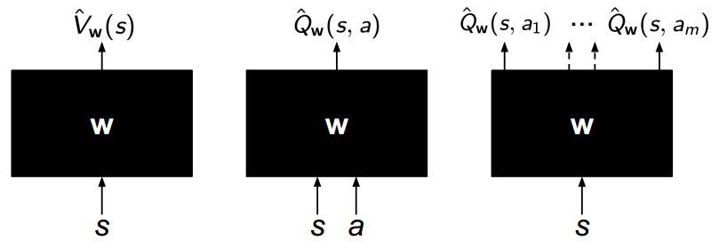
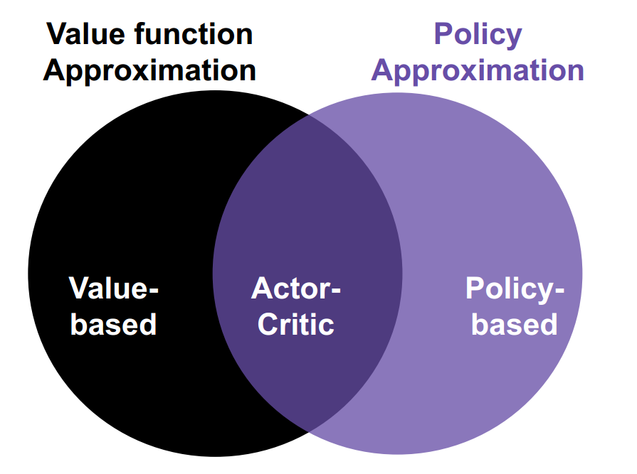

# Introduction to Deep Reinforcement Learning

## Value-based Method

### Approximation of State and Action Value Functions

In this note, we will be talking about value function approximation and policy gradient methods. These methods include many widely used algorithms in practical RL problems.

In previous lectures, we talk about Monte-Carlo and Temporal-Difference Learning (both in prediction and control settings). In those methods, the value function estimations are in finite look-up tables, such as $\hat{V}(s)$ for every state s, or $\hat{Q}(s, a)$ for every state-action pair $(s, a)$.

In practical reinforcement learning problems, they always involve large or continuous state
spaces, such as Computer Go game, helicopter control, robotics, etc.

So for large state spaces, there exits the following problems: (1) There may be too many (even an infinite) number of states or actions to store in memory. (2) It may be too slow or wasteful to learn the value of each state individually.

In order to resolve above issues for large state space, we may instead estimate values with function approximation. We can use parameterized representations to approximate the state value function and action value function:

- $\hat{V}^\pi(s) \approx V_\mathbf{W}(s)$
- $\hat{Q}^\pi(s, a) \approx Q_\mathbf{W}(s, a)$.

where $\mathbf{W}$ is the parameter of the function approximator, such as neural network weights. Such parameterized representations can help generalize values from seen to unseen states.

Typically, there are three types of value function approximation, shown as following figure.


*Types of value function approximation*

Here $\mathbf{W}$ in above figure is the weight of the function approximator. As shown in the above figure, we can (1) approximate value function with state $s$ as input; (2) approximate action value function with state $s$ and action $a$ as inputs; (3) approximate action value functions for each possible action $a$, with state $s$ as input.

The function approximator needs to be differentiable in order to update the parameters via gradient-based methods. Thus the function approximator could be:

- Linear combination of features, e.g. $\hat{V}_\mathbf{W}(s) =  \sum_i \mathbf{W_i} f_i(s)$, and $\hat{Q}_\mathbf{W}(s, a) =  \sum_i \mathbf{W_i} f_i(s, a)$
- Deep Neural network (default choice)

### Value Function Approximation Methods

In order to estimate $\hat{V}_\mathbf{w}$  or $\hat{Q}_\mathbf{w}$, we need some objective to optimize. Let's consider a differentiable objective function: $J(\mathbf{w})$ and the optimization goal $\underset{\mathbf{w}}{\min} J(\mathbf{w})$. The update of the weights $\mathbf{w}$ in each gradient descent step is,

$$
\begin{aligned}
\Delta \mathbf{w} &= -\frac{1}{2} \alpha \nabla_\mathbf{w} J(\mathbf{w}) \\
& = -\frac{1}{2}
\alpha \begin{bmatrix}
\frac{\partial J(\mathbf{w})}{\partial \mathbf{w}_1} \\
\vdots \\
\frac{\partial J(\mathbf{w})}{\partial \mathbf{w}_n} \\
\end{bmatrix}
\end{aligned}
$$

Thus we can find the local minimum by following the opposite direction of the gradient. (gradient descent). And $\alpha$ is a step-size parameter.

Then we apply similar idea to the value function approximation. Our goal is to minimize mean-squared error between true value function $V^\pi$ and approximate value function $\hat{V}_\mathbf{w}$ across states. Thus the optimization object is

$$
J(\mathbf{w}) = \mathbb{E}_\eta \big[ (V^\pi(s) - \hat{V}_\mathbf{w}(s))^2  \big]
$$

where $\eta$ is a distribution over states. And the update of the weights $\mathbf{w}$ in each gradient descent step is,

$$
\begin{aligned}
\Delta \mathbf{w}  &= -\frac{1}{2} \alpha \nabla_\mathbf{w} J(\mathbf{w}) \\
& = \alpha \mathbb{E}_\eta \big[ (V^\pi(s) - \hat{V}_\mathbf{w}(s)) \nabla_\mathbf{w} \hat{V}_\mathbf{w}(s) \big]
\end{aligned}
$$

In stochastic gradient descent, we sample the gradient, which makes the update as,

$$
\Delta \mathbf{w} = \alpha \big[ (V^\pi(s) - \hat{V}_\mathbf{w}(s)) \nabla_\mathbf{w} \hat{V}_\mathbf{w}(s) \big]
$$

This equals the full gradient update in expectation.

### On-policy prediction

Next, let's talk about Incremental prediction. In a real scenario, we don’t know the true value function $V^\pi$. In its place, we must substitute $V^\pi$ with a target $T_v$ from rewards.

Thus the prediction algorithms are shown as follows. We can obtain the target $T_v$ with both MC and TD approaches.

Algorithm: General form of Approximation Prediction Algorithm
```python
def approximate_prediction(
    policy, method, sample_episode, initial_state, take_step,
    compute_target, value, value_gradient, initialize_weights,
    num_episodes, max_steps, alpha,
):
    """compute_target handles the selected MC, TD(0), or n-step target."""
    weights = initialize_weights()

    for _ in range(num_episodes):
        if method == "MC":
            episode = sample_episode(policy)
            for t, transition in enumerate(episode):
                state = transition[0]
                target = compute_target(episode, t)
                weights += alpha * (target - value(weights, state)) * value_gradient(
                    weights, state
                )
        elif method == "TD":
            state = initial_state()
            for _ in range(max_steps):
                action = policy(state)
                next_state, reward, done = take_step(state, action)
                transition = (state, action, reward, next_state)
                target = compute_target(transition)
                weights += alpha * (target - value(weights, state)) * value_gradient(
                    weights, state
                )
                state = next_state
                if done:
                    break
        else:
            raise ValueError("method must be 'MC' or 'TD'")

    return weights
```

The target $T_v$ in the above algorithm is different by using different types of prediction methods, such as MC, TD(0) and n-step TD.
<!-- \begin{figure}[ht] -->
<!-- \centering -->
<!-- \includegraphics[scale=0.32]{figs/targets.png} -->
<!-- \caption{Different types of targets for value function approximation} -->
<!-- \end{figure} -->

- MC target: $G_t = \sum_{k=0}^{T-t} \gamma^k r_{t+k} $
- TD target: $r_t + \gamma \hat{V}_\mathbf{w}(s_{t+1})$
- n-step TD target: $r_t + \gamma r_{t+1} + \cdots + \gamma^{n-1} r_{t+n} + \gamma^n V_\mathbf{w}(s_{t+n})$

### On-policy control

Next let's talk about incremental control. Like the model-free control algorithms, we will continue using estimate value function in order to find optimal policy. The update of weights in action value function approximation is,

$$
\Delta \mathbf{w} = \alpha \big[ (Q^\pi(s, a) - \hat{Q}_\mathbf{w}(s, a)) \nabla_\mathbf{w} \hat{Q}_\mathbf{w}(s, a) \big]
$$

And similarly, we will also have a target for $Q$ value: $T_q$ since the true action value function is also unknown. As before, we must also continuously improve policy $\pi$, such as $\epsilon$-greedy wrt $Q$. So the general form of incremental control algorithm is shown as,

Algorithm: General form of Approximation Control Algorithm
```python
def approximate_control(
    policy, method, sample_episode, initial_state, take_step,
    compute_target, q_value, q_gradient, improve_policy,
    initialize_weights, num_episodes, max_steps, alpha,
):
    """compute_target handles the selected MC, SARSA, or Q-learning target."""
    weights = initialize_weights()

    for _ in range(num_episodes):
        if method == "MC":
            episode = sample_episode(policy)
            for t, transition in enumerate(episode):
                state, action = transition[:2]
                target = compute_target(episode, t)
                weights += alpha * (target - q_value(weights, state, action)) * q_gradient(
                    weights, state, action
                )
            policy = improve_policy(policy, q_value, weights, episode)
        elif method == "TD":
            state = initial_state()
            for _ in range(max_steps):
                action = policy(state)
                next_state, reward, done = take_step(state, action)
                transition = (state, action, reward, next_state, done)
                target = compute_target(transition)
                weights += alpha * (target - q_value(weights, state, action)) * q_gradient(
                    weights, state, action
                )
                policy = improve_policy(policy, q_value, weights, state)
                state = next_state
                if done:
                    break
        else:
            raise ValueError("method must be 'MC' or 'TD'")

    return policy, weights
```

Similarly, different types of target $T_q$ is shown as following table, such as by using MC, Sarsa(0) and Q-Learning.

<!-- \begin{figure}[ht!] -->
<!-- \centering -->
<!-- \includegraphics[scale=0.35]{figs/targets_q.png} -->
<!-- \caption{Different types of targets for incremental control} -->
<!-- \end{figure} -->

- MC target: $G_t = \sum_{k=0}^{T-t} \gamma^k r_{t+k} $
- Sarsa(0) target: $r_t + \gamma \hat{Q}_\mathbf{w}(s_{t+1}, a_{t+1})$
- Q-learning target: $r_t + \gamma \max_a \hat{Q}_\mathbf{w}(s_{t+1}, a)$

### Deep Q-Learning (DQN)

DQN is one of the major breakthrough in deep reinforcement learning. It achieves human level Atari game playing.

Bellman optimal equation for Q-value,

$$
Q^{*}(s,a) = \mathbb{E}_{s' \sim \tau} \left[r + \gamma \text{max}_{a'} Q^*(s',a'; \boldsymbol{\theta}_i))\right]
$$

We have TD target as,

$$
y_i = \mathbb{E}_{s' \sim \tau} \left[r + \gamma \text{max}_{a'} Q^(s',a'; \boldsymbol{\theta}_i))\right]
$$

TD error to formulate the loss function of DQN,

$$
L_i(\boldsymbol{\theta}_i) = \mathbb{E}_{(s,a) \sim \tau} \left[y_i - Q(s,a; \boldsymbol{\theta}_i))\right]
$$

Apply gradient updates for loss function

$$
\nabla_{\boldsymbol{\theta}_i}L_i(\boldsymbol{\theta}_i) = \mathbb{E}_{(s,a,s') \sim \tau} \left[ (y_i - Q(s,a; \boldsymbol{\theta}_i))\nabla_{\boldsymbol{\theta}_i}Q(s,a;\boldsymbol{\theta}_i) \right]
$$

The algorithm of DQN is shown as,

```python
import copy
import random
import torch
from torch.optim import Adam

q_w = QNetwork()
q_target = copy.deepcopy(q_w)
replay_buffer = ReplayBuffer()
burn_in_replay_buffer(env, replay_buffer, policy=random_policy)
optimizer = Adam(q_w.parameters())
c = 0

for episode in range(E):
    state = env.reset()

    for t in range(T):
        if random.random() < 1 - epsilon:
            action = q_w(state).argmax().item()
        else:
            action = env.action_space.sample()

        next_state, reward, done = env.step(action)
        replay_buffer.add(state, action, reward, next_state, done)
        states, actions, rewards, next_states, dones = replay_buffer.sample(N)

        with torch.no_grad():
            next_q_values = q_target(next_states).max(dim=1).values
        targets = torch.where(dones, rewards, rewards + gamma * next_q_values)
        q_values = q_w(states).gather(1, actions.unsqueeze(1)).squeeze(1)
        loss = ((targets - q_values) ** 2).mean()

        optimizer.zero_grad()
        loss.backward()
        optimizer.step()

        c += 1
        if c % 50 == 0:
            q_target.load_state_dict(q_w.state_dict())

        state = next_state
        if done:
            break
```

Two different points to notice:

- Replay buffer is used to store trajectories and train the network online.
- Policy is generated from the $\epsilon-$greedy method based on learned Q value
- DQN is off-policy. We have behavior value function $Q_{\omega}$ and target value function $Q_{target}$

## Policy Gradient Methods

### Intro to policy gradient methods

In this tutorial we will introduce the Policy Gradient methods. It is one type of policy search methods which directly learns a policy. For Value function approximation approaches, the policy was generated using the value function, such as $\epsilon$-greedy. Next we will look at methods that directly parameterize the policy, which is $\pi_\theta(a|s)  = p(a | s; \theta)$. Here $\theta$ denotes the parameter of the policy approximator.

If we combine value based and policy based methods, we have actor-critic method. The relationship of value based, policy based and actor-critic methods are summarized by the following Venn diagram.


*Relationship of value based, policy based and actor-critic methods*

For policy gradient methods, we will be talking about Monte-Carlo policy gradient(also known as REINFORCE) and Q actor-critic and Advantage actor-critic. The details of those algorithms will be introduced in the next section.

### Overview of policy gradient methods

Next we will talk about policy gradient algorithms. The algorithms we will go through are Monte Carlo Policy Gradient and Actor-Critic Methods.

Similar to value function approximation, we need an objective $J(\theta)$ to optimize. We search for a local maximum in this case: $\underset{\theta}{\max} J(\theta)$.

The gradient ascent update step for weight parameter $\theta$ is,

$$
\begin{aligned}
\Delta \theta &= \alpha \nabla_\theta J(\theta) \\
& =
\alpha \begin{bmatrix}
\frac{\partial J(\theta)}{\partial \theta_1} \\
\vdots \\
\frac{\partial J(\theta)}{\partial \theta_n} \\
\end{bmatrix}
\end{aligned}
$$

And for simplicity, we consider the episodic case, where each episode starts in a state $s_0$. Our objective is simply the value function start from state $s$:

$$
J(\theta) = V^{\pi_\theta} (s)
$$

In order to compute the gradient over the objective function, we provide Policy Gradient Theorem shown as,

$$
\begin{aligned}
\nabla_\theta J(\theta) &= \sum_s \eta(s) \sum_a Q ^{\pi_\theta} (s, a) \nabla_\theta \pi_\theta(a|s) \\
& = \mathbb{E}_{\pi} \left[ \sum_a Q ^{\pi_\theta} (s, a) \nabla_\theta \pi_\theta(a|s) \right]
\end{aligned}
$$

where $\eta(s)$ is the probability of transitioning $s$ to the terminal state $s_T$, after $k$ steps, under policy $\pi$. Or we can understand it as the probability of generating a trajectory with terminal state $s_T$ following policy $\pi$.

The proof of policy gradient theory is shown as follows,

$$
\begin{aligned}
\nabla_\theta J(\theta) &= \nabla_\theta \left[  V^{\pi_\theta} (s) \right] \\
& = \nabla_\theta \left[ \sum_a  \pi_\theta(a|s) Q ^{\pi_\theta} (s, a) \right] \\
& = \sum_a \left[\nabla_\theta \pi_\theta(a|s) Q ^{\pi_\theta} (s, a) + \pi_\theta(a|s) \nabla_\theta Q ^{\pi_\theta} (s, a) \right] \\
& = \sum_a \left[\nabla_\theta \pi_\theta(a|s) Q ^{\pi_\theta} (s, a) + \pi_\theta(a|s) \nabla_\theta \sum_{s,a}p(s',r|s,a)(r + V^{\pi_\theta}(s')) \right] \\
& = \sum_a \left[\nabla_\theta \pi_\theta(a|s) Q ^{\pi_\theta} (s, a) + \pi_\theta(a|s) \sum_{s,a}p(s',r|s,a)\nabla_\theta V^{\pi_\theta}(s') \right] \\
& = \sum_a \Bigg[ \nabla_\theta \pi_\theta(a|s) Q ^{\pi_\theta} (s, a) + \pi_\theta(a|s) \sum_{s,a}p(s',r|s,a) \\
&\left(\sum_{a'} \Big[ \nabla_\theta \pi_\theta(a'|s') Q ^{\pi_\theta} (s', a') + \pi_\theta(a'|s') \nabla_\theta \sum_{s'',a'}p(s'',r'|s',a')(r' + V^{\pi_\theta}(s'')) \right) \Bigg] \\
& = \sum_a \Big[ \nabla_\theta \pi_\theta(a|s) Q ^{\pi_\theta} (s, a) \Big] + \pi_\theta(a|s) \sum_{s,a}p(s',r|s,a)\sum_{a'} \Big[ \nabla_\theta \pi_\theta(a'|s') Q ^{\pi_\theta} (s', a')\Big] + \cdots \\
& = 1 \cdot \sum_a \Big[ \nabla_\theta \pi_\theta(a|s) Q ^{\pi_\theta} (s, a) \Big] + \eta(s') \sum_{a'} \Big[ \nabla_\theta \pi_\theta(a'|s') Q ^{\pi_\theta} (s', a')\Big] + \cdots \\
&= \sum_s \eta(s) \left[ \sum_a \nabla_\theta \pi_\theta(a|s) Q ^{\pi_\theta} (s, a) \right] \\
\end{aligned}
$$
<!-- & = \sum_a \left[\nabla_\theta \pi_\theta(a|s) Q ^{\pi_\theta} (s, a) + \pi_\theta(a|s) \sum_{s,a}p(s',r|s,a)\nabla_\theta   \right] \\ -->

In terms of samples, we will apply importance sampling we discussed before.

$$
\begin{aligned}
\nabla_\theta J(\theta) &= \sum_s \eta(s) \sum_a Q ^{\pi_\theta} (s, a) \nabla_\theta \pi_\theta(a|s) \\
&= \mathbb{E}_{s \sim \eta} \Big[ \sum_a Q ^{\pi_\theta} (s, a) \nabla_\theta \pi_\theta(a|s) \Big] \\
&= \mathbb{E}_{s \sim \eta} \Big[ \sum_a \pi_\theta(a|s) Q ^{\pi_\theta} (s, a)  \frac{\nabla_\theta \pi_\theta(a|s)}{\pi_\theta(a|s)} \Big] \\
&= \mathbb{E}_{s \sim \eta, a\sim \pi} \Big[Q ^{\pi_\theta} (s, a)  \nabla_\theta \ln \big( \pi_\theta(a|s) \big) \Big] \\
\end{aligned}
$$

This means we sample $a$ from policy $\pi$, and Q function is actually the expected return $G_t$.

$$
\begin{aligned}
\nabla_\theta J(\theta) &= \mathbb{E}_{s \sim \eta, a\sim \pi} \left[Q ^{\pi_\theta} (s, a)  \nabla_\theta \ln \left( \pi_\theta(a|s) \right) \right] \\
&=\mathbb{E}_{s \sim \eta, a\sim \pi} \left[ \mathbb{E}_{s \sim \eta, a\sim \pi} \left[G_t\right]\nabla_\theta \ln \left( \pi_\theta(a|s) \right) \right] \\
&=\mathbb{E}_{s \sim \eta, a\sim \pi} \left[ G_t\nabla_\theta \ln \left( \pi_\theta(a|s) \right) \right] \\
\end{aligned}
$$

This led to the algorithm called Monte-Carlo policy gradient, aka REINFORCE.

### Monte Carlo Policy Gradient (REINFORCE) 

The first Policy Gradient we will be visiting is Monte-Carlo Policy Gradient, also named REINFORCE.

We want to update parameters $\theta$ by stochastic gradient ascent using samples of interaction. Episode return $G_t$ is an unbiased sample of $Q ^{\pi_\theta} (s_t, a_t)$. Therefore, we consider the update as:

$$
\Delta \theta_t =  \alpha G_t \nabla_\theta \ln \pi_\theta(s_t, a_t)
$$

With this updating, we can then introduce the REINFORCE algorithm,

Algorithm: REINFORCE
```python
def reinforce(
    initialize_theta, sample_episode, log_policy_gradient,
    is_converged, alpha, gamma,
):
    theta = initialize_theta()

    while not is_converged(theta):
        episode = sample_episode(theta)
        returns = [0.0] * len(episode)
        G = 0.0

        for t in range(len(episode) - 1, -1, -1):
            _state, _action, reward, _next_state = episode[t]
            G = reward + gamma * G
            returns[t] = G

        gradient = 0
        for (state, action, _reward, _next_state), G in zip(episode, returns):
            gradient += G * log_policy_gradient(theta, state, action)

        theta += alpha * gradient

    return theta
```

### Actor-Critic Methods

One of the major problems of REINFORCE is that it has high variance since it uses an unbiased estimation of action value function $Q ^{\pi_\theta} (s_t, a_t)$ via $G_t$. Thus to reduce the high variance in REINFORCE, we consider using a critic parameterized by $\mathbf{w}$ to estimate the action value function, which is

$$
Q ^{\pi_\theta} (s_t, a_t) \approx \hat{Q}_\mathbf{w} (s_t, a_t)
$$

These types of policy gradient algorithm are called actor-critic methods.

Actor-critic algorithms follow an approximate policy gradient:

$$
\mathbb{E}_{s \sim \eta, a\sim \pi} \Big[\hat{Q}_\mathbf{w} (s, a)  \nabla_\theta \ln \pi_\theta(a|s) \Big]
$$

Thus actor-critic methods have two sets of parameters $\theta$ and $\mathbf{w}$ for actor and critic.
(1) Actor updates policy parameters $\theta$ using direction suggested by critic:

$$
\Delta \theta = \alpha \hat{Q}_\mathbf{w} (s_t, a_t)  \nabla_\theta \ln \pi_\theta(s_t, a_t)
$$

(2) And critic updates state-action value function parameters $\mathbf{w}$, using any prediction method, for example:

- Monte Carlo: $\nabla \mathbf{w} = \alpha (G_t - \hat{Q}_\mathbf{w}(s, a)) \nabla_\mathbf{w} \hat{Q}_\mathbf{w}(s, a)$
- TD(0): $\nabla \mathbf{w} = \alpha \big[ R_t + \gamma \hat{Q}_\mathbf{w}(s_t, a_t) - \hat{Q}_\mathbf{w}(s, a) \big] \nabla_\mathbf{w} \hat{Q}_\mathbf{w}(s, a)$

With this update, we can obtain our first actor-critic algorithm called Q actor-critic.

Algorithm: Q actor-critic
```python
def q_actor_critic(
    initialize_theta, initialize_weights, sample_episode, sample_steps,
    compute_updates, is_converged, method,
):
    theta = initialize_theta()
    weights = initialize_weights()

    while not is_converged(theta, weights):
        if method == "MC":
            transitions = sample_episode(theta)
        elif method == "TD":
            transitions = sample_steps(theta)
        else:
            raise ValueError("method must be 'MC' or 'TD'")

        for transition in transitions:
            theta_update, weights_update = compute_updates(theta, weights, transition)
            weights += weights_update
            theta += theta_update

    return theta, weights
```

To reduce the variance of Q actor-critic, We consider subtracting a baseline $B(s)$ from $Q ^{\pi_\theta} (s, a)$, Then we have:

$$
\begin{aligned}
& \mathbb{E}_{s \sim \eta, a\sim \pi} \Big[\big( Q ^{\pi_\theta} (s, a) - B(s) \big) \nabla_\theta \log \pi_\theta(a|s) \Big] \\
&= \nabla_\theta J(\theta) - \mathbb{E}_{s \sim \eta, a\sim \pi} \Big[B(s) \nabla_\theta \log \pi_\theta(a|s) \Big] \\
&= \nabla_\theta J(\theta) - \mathbb{E}_{s \sim \eta} \Big[\sum_a \pi_\theta (s, a) B(s) \frac{\nabla_\theta\pi_\theta(a|s) }{\pi_\theta (s, a)} \Big] \\
&= \nabla_\theta J(\theta) - \mathbb{E}_{s \sim \eta} \Big[B(s) \sum_a \nabla_\theta\pi_\theta(a|s) \Big] \\
&= \nabla_\theta J(\theta) - \mathbb{E}_{s \sim \eta} \Big[B(s) \nabla_\theta \sum_a \pi_\theta(a|s) \Big] \\
&= \nabla_\theta J(\theta) - \mathbb{E}_{s \sim \eta} \Big[B(s) \times 0 \Big] \\
&= \nabla_\theta J(\theta)
\end{aligned}
$$

This shows that the use of a baseline that depends only on the state s can be used to reduce variance without affecting the expectation.

### Advantage function

Following the idea of baseline, we have an advantage function which is often used in Actor-Critic methods. The simplest advantage function is

$$
\begin{aligned}
A(s, a) &= Q(s, a) - V(s) \\
&= r + \gamma V(s') - V(s)
\end{aligned}
$$

Then the objective function for Advantage Actor-Critic (A2C) is,
Actor-critic algorithms follow an approximate policy gradient:

$$
\mathbb{E}_{s \sim \eta, a\sim \pi} \Big[ \left(\hat{Q}_\mathbf{w} (s, a) - \hat{V}_{\boldsymbol{\phi}}(s) \right)  \nabla_\theta \ln \pi_\theta(a|s) \Big]
$$

## Comparison of Value-based and PG Methods

The advantages of policy gradient methods are:

- Useful in large or continuous action spaces.

- In problems with significant approximation, learning a stochastic policy might be best.

- The choice of policy parameterization is a way to inject prior knowledge about the desired form of the policy into the learning process.

- Stronger convergence guarantees for these methods as action probabilities

change smoothly as a function of learned parameters.

And the downside of policy search methods are:

- Typically converges to a local rather than a global optimum.

- Evaluating a policy may be inefficient and of high variance.


## References
[1] Volodymyr Mnih et. al. “Human-level control through deep reinforcement learning.” *Nature* (2015).

