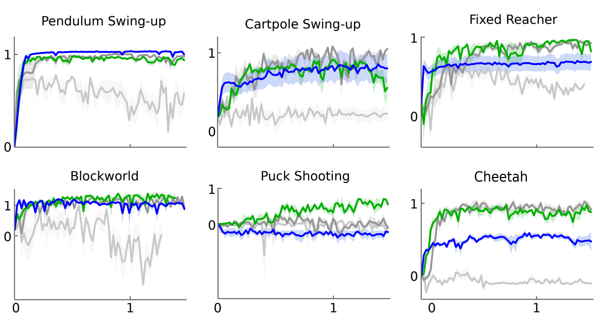
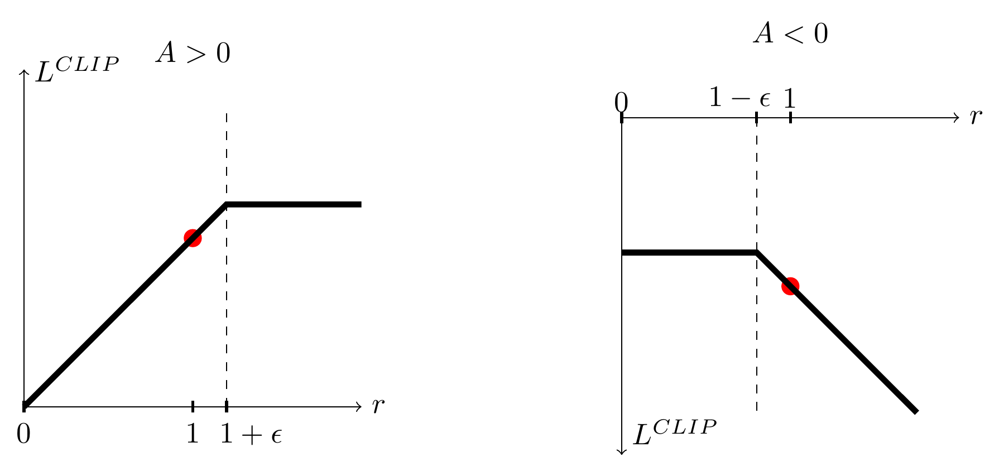
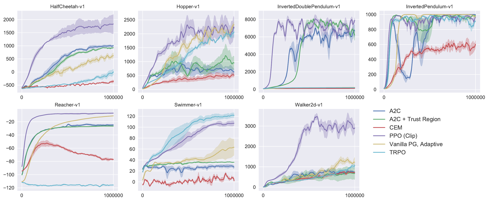

## Deep Deterministic Policy Gradient (DDPG)

### Introduction

In this note, we will be discussing one of the classic RL papers named Deep Deterministic Policy Gradient (DDPG) [1]. DDPG is an adaptation of deep Q-learning and policy gradient in a continuous domain. It is based on its predecessor DPG [2] and is one of the early works that applied policy gradient to continuous control tasks in deep learning era.

### Key Contributions

DDPG is an off-policy actor-critic RL method that has an actor network to obtain a deterministic continuous policy, and a critic network to estimate value function. This critic net is similar to the Q-network in DQN [3]. But different from DQN which is used only in discrete RL tasks such as Atari games, DDPG can do continuous tasks such as balancing a simple bipedal walker.

#### Critic network

The optimizing procedure for the critic network is

$$
L(\boldsymbol{\theta}^{Q}) = \mathbb{E} \left[ \left( Q(s_t, a_t|\boldsymbol{\theta}^{Q}) - y_t \right)^2 \right]
$$

with the TD target being calculated based on standard 1-step bootstrapping:
<a id="eq-TD_target"></a>

$$
y_t = r(s,a) + \gamma  Q^{\pi}(s_{t+1}, \mu(s_{t+1})|\boldsymbol{\theta}^{Q})
$$

where $\mu$ denotes the behavior policy.

#### Actor network

We try to learn a policy that maximizes the expected return, denoted as the expectation of the estimated action value function.

$$
J = \mathbb{E} \left[ Q^{\pi}(s, a|\boldsymbol{\boldsymbol{\theta}}^{Q}) \right]
$$

We will use a gradient-based update for actor network weights $\mu$, which gives us the gradient as

$$
\begin{aligned}
&\nabla_{\boldsymbol{\theta}^{\mu}} J = \nabla_{\boldsymbol{\theta}^{\mu}} \mathbb{E}_{s_i \sim \rho^{\beta}} \left[ Q^{\pi}(s, a|\boldsymbol{\theta}^{Q})|_{s=s_i, a=\mu(s_i)} \right] \\
&= \mathbb{E}_{s_i \sim \rho^{\beta}} \left[ \nabla_{\boldsymbol{\theta}^{\mu}}  Q^{\pi}(s, a|\boldsymbol{\theta}^{Q})|_{s=s_i, a=\mu(s_i)} \right] \\
&= \mathbb{E}_{s_i \sim \rho^{\beta}}\left[ \nabla_a Q^{\pi}(s, a|\boldsymbol{\theta}^{Q})|_{s=s_i, a=\mu(s_i)} \nabla_{\boldsymbol{\theta}^{\mu}} \mu(s|\boldsymbol{\theta}^{\mu})|_{s_i} \right]
\end{aligned}
$$

(Note that the above equation is not a fully derived version of the policy gradient theorem)

And here $\rho^{\beta}$ is the trajectory collected by the behavior policy. This gradient-based update is a policy gradient. We will use actor network to interact with the environment, the action is from the actor network with exploration noise added.

$$
a_t = \mu(s_t|\boldsymbol{\theta}^{\mu}) + \mathcal{N}_t
$$

<!-- \begin{equation} -->
<!-- \nabla_{\boldsymbol{\theta}^{\mu}} J = \frac{1}{N} \sum_{i} \nabla_a Q^{\pi}(s, a|\boldsymbol{\theta}^{Q})|_{s=s_i, a=\mu(s_i)} \nabla_{\boldsymbol{\theta}^{\mu}} \mu(s|\boldsymbol{\theta}^{\mu})|_{s_i} -->
<!-- \end{equation} -->

#### Target networks

DDPG has two copies of critic and actor network: critic $Q$ and target critic $Q'$; actor $\mu$ and target actor $\mu'$. We use target actor net to formulate the TD target shown in equation [eq:TD_target](#eq-TD_target). While actor network is used to interact with the environment and collect data for training. The target networks will be updated separately as:

For target critic net's weights:

$$
\boldsymbol{\theta}^{Q'} = \tau \boldsymbol{\theta}^{Q} + (1-\tau) \boldsymbol{\theta}^{Q'}
$$

For target actor net's weights:

$$
\boldsymbol{\theta}^{\mu'} = \tau \boldsymbol{\theta}^{\mu} + (1-\tau) \boldsymbol{\theta}^{\mu'}
$$

### Overall algorithm

The algorithm is shown as following, note that we are using a replay buffer just like DQN [3] to stabilize learning.

```python
import copy
import torch
from torch.optim import Adam

def soft_update(target, source, tau):
    for target_param, source_param in zip(target.parameters(), source.parameters()):
        target_param.data.copy_(tau * source_param.data + (1 - tau) * target_param.data)

critic = CriticNetwork()
actor = ActorNetwork()
target_critic = copy.deepcopy(critic)
target_actor = copy.deepcopy(actor)
replay_buffer = ReplayBuffer()

critic_optimizer = Adam(critic.parameters())
actor_optimizer = Adam(actor.parameters())

for episode in range(M):
    noise = RandomProcess()
    noise.reset()
    state = env.reset()

    for t in range(T):
        action = actor(state) + noise.sample()
        next_state, reward, _ = env.step(action)
        replay_buffer.add(state, action, reward, next_state)

        states, actions, rewards, next_states = replay_buffer.sample(N)

        with torch.no_grad():
            next_actions = target_actor(next_states)
            targets = rewards + gamma * target_critic(next_states, next_actions)

        critic_values = critic(states, actions)
        critic_loss = ((targets - critic_values) ** 2).mean()
        critic_optimizer.zero_grad()
        critic_loss.backward()
        critic_optimizer.step()

        actor_loss = -critic(states, actor(states)).mean()
        actor_optimizer.zero_grad()
        actor_loss.backward()
        actor_optimizer.step()

        soft_update(target_critic, critic, tau)
        soft_update(target_actor, actor, tau)
        state = next_state
```

## Key Experimental Results

The following figures show the normalized rewards obtained by DDPG in several continuous control tasks. The results in this paper are mainly used to demonstrate the effectiveness of the target networks. We can just focus on two curves which are the light gray (without target networks) one and dark gray (with target networks) one. We can see that by applying target networks the performance can improve quite significantly.


<!-- \label{fig:my_label} -->

## Proximal Policy Gradient (PPO) 

### Introduction

In this note we will talk about one trust region-based policy gradient method - Proximal Policy Gradient (PPO) [4]. PPO is now one of the most widely used policy gradient methods, such as being used in recently insanely popular chatbot-chatGPT. PPO is developed upon Trust Region Policy Optimization (TRPO) [5].

### Quick into to TRPO

The standard policy gradient optimization objective is:

$$
L^{PG} (\theta)  = \mathbb{E} \left[ \log \pi_\theta(a|s) A(s, a) \right]
$$

where $A(s, a)$ is the advantage function.

Thus the gradient is computed as

$$
\nabla_{\theta} L^{PG} (\theta) = \mathbb{E} \left[ \nabla_{\theta} \log \pi_\theta(a|s) A(s, a) \right]
$$

In classic policy gradient methods like DDPG, the policy is optimized by the data collected from the same policy. As the policy being updated in each iteration, new data is generated to optimize the policy but old data in previous iterations cannot be used again. This hinders the sample efficiency of policy gradient methods. To solve this problem, TRPO uses importance sampling to use old data to optimize the policy network. Thus the new objective, called conservative policy iteration (CPI), is written as,

$$
L^{CPI} (\theta)  = \mathbb{E} \left[ \frac{\pi_\theta(a|s)}{\pi_{\theta_{old}}(a|s)} A(s, a) \right] =  \mathbb{E} \left[ \rho(\theta) A(s, a) \right]
$$

This brings another problem, importance sampling ratio $\rho(\theta)$ could be very large or small if the $\pi_\theta$ changes too much compared with $\pi_{\theta_{old}}$. Large policy change may collapse the training. To avoid this issue, TRPO limits the change of policy parameters by constraining the KL divergence of $\pi_\theta$ and $\pi_{\theta_{old}}$. Thus the optimization objective of TRPO is shown as follows, and is called surrogate objective. It constrains the size of the policy update to avoid large policy updates.
<a id="equa-CLP"></a>

$$
\begin{aligned}
& L (\theta)  = \mathbb{E} \left[ \frac{\pi_\theta(a|s)}{\pi_{\theta_{old}}(a|s)} A(s, a) \right] \\
& \text{s.t.     } \mathbb{E} \left[ KL (\pi_\theta(a|s), \pi_{\theta_{old}}(a|s)) \right] \leq \delta
\end{aligned}
$$

This objective can  be approximately solved using the conjugate gradient algorithm, after making a linear approximation to the objective and a quadratic approximation to the constraint.

### PPO

PPO is developed based on TRPO and is much simpler to implement, more general, and have better sample complexity empirically. We will talk about the optimization objectives in the next sub-sections.

#### Clipped Surrogate Objective

Let's first talk about clipped surrogate objective. We can clip the importance ration to avoid overly large change of the policy.

$$
L^{CLIP} (\theta)  = \mathbb{E} \left[ \min(\rho(\theta) A(s,a), \text{clip}(\rho(\theta), 1+\epsilon, 1-\epsilon)A(s,a) \right]
$$

The clip function can be visualized as the following plots. When the advantage function $A$ is positive, any ratio that is larger than $1+\epsilon$ is clipped.


<!-- \label{fig:my_label} -->

#### Adaptive KL Penalty Coefficient

Back to equation [equa:CLP](#equa-CLP), we can solve this unconstrained optimization problem with Lagrangian duality as

$$
L^{KLPEN} (\theta)  = \mathbb{E} \left[ \frac{\pi_{\theta(a|s)}}{\pi_{\theta_{old}}(a|s)} A(s, a) - \beta  KL (\pi_\theta(a|s), \pi_{\theta_{old}}(a|s)) \right]
$$

This is a optimization objective with a KL penalty. This objective can be an alternative to clipped surrogate objective. We also need to change the penalty term $\beta$. The updating rule used in PPO is shown as,

- Set a target KL divergence value $d_{tgt}$ as one of the hyper-parameters
- Compute divergence term as $d = \mathbb{E} \left[ KL (\pi_\theta(a|s), \pi_{\theta_{old}}(a|s))  \right]$
  - if $d < d_{tgt}/1.5$, then $\beta = \beta/2$
  - if $d > d_{tgt} \times 1.5$, then $\beta = \beta \times 2$

The idea is simple, when the current KL divergence value is larger then a threshold, then increase the penalty term $\beta$, other wise decrease it.

#### PPO algorithm

Combining the optimization objectives mentioned before, we have the following final optimization objective used in PPO,

$$
L^{PPO} (\theta)  = \mathbb{E} \left[ L^{CLIP} (\theta) - c_1 (V_{\theta}(s)-V^{tgt})^2 + c_2 S[\pi_{\theta}] (s_t) \right]
$$

$c_1$ and $c_2$ are coefficients. $S$ denotes an entropy bonus term. This objective combines policy optimization, value optimization as well as some exploration brought by the entropy bonus $S$.

The advantage function used in PPO is a $T$ step (much less than the episode length) look-ahead value estimation,

$$
A_t = - V(s_t) + r_t + \gamma r_{t+1} + \cdots + \gamma^{T-t+1} r_{T-1} + \gamma ^{T-t} V(s_{T})
$$

In the implementation of PPO , the algorithm run $N$ actors in parallel.

### Key Experimental Results

Tested in Mujoco environments, PPO outperforms other baseline algorithms in most cases and shows more efficient learning capability.


<!-- \label{fig:my_label} -->

## Summaries and Discussions

Pros:

- PPO can achieve similar and even better results compared with TRPO, but easier to implement.
- PPO is a sample efficient PG algorithm, even more efficient than TRPO.

Cons:

- The $T$ step look-ahead advantage function used in PPO could make the algorithm a bit short-sighted.
- PPO is empirically shown to be sensitive to hyper-parameters.

## Introduction

In this note, we will talk about one max-entropy-based RL methods, Soft Actor-Critic [1].

## Key Components

### Quick intro to Max-entropy RL

Recall the definition of entropy
$$
H(x) = - \sum p(x)\log(p(x))
$$

Max-entropy (MaxEnt) RL is proved to be robust to some disturbances in the dynamics and the reward
function [2].

### PPO

SAC is an *off-policy* MaxEnt RL algorithm.

## Key Experimental Results

## Summaries and Discussions

Pros:

Cons:


## References

[1] Timothy P. Lillicrap, Jonathan J. Hunt, Alexander Pritzel, Nicolas Heess, Tom Erez, Yuval Tassa, David Silver, Daan Wierstra. “CONTINUOUS CONTROL WITH DEEP REINFORCEMENT LEARNING.” *ICLR* (2016).

[2] David Silver, Guy Lever, Nicolas Heess, Thomas Degris, Daan Wierstra, Martin Riedmiller. “Deterministic Policy Gradient Algorithms.” *ICML* (2014).

[3] John Schulman, Filip Wolski, Prafulla Dhariwal, Alec Radford, Oleg Klimov. “Proximal Policy Optimization Algorithms.” *arXiv:1707.06347v2* (2017).

[4] John Schulman, Sergey Levine, Philipp Moritz, Michael I. Jordan, Pieter Abbeel. “Trust Region Policy Optimization.” *ICML* (2015).

[5] Haarnoja, Tuomas, Zhou, Aurick, Abbeel, Pieter, Levine, Sergey. “Soft Actor-Critic: Off-Policy Maximum Entropy Deep Reinforcement Learning with a Stochastic Actor.” *Proceedings of the 35th International Conference on Machine Learning*. (2018).

[6] Benjamin Eysenbach, Sergey Levine. “Maximum Entropy RL (Provably) Solves Some Robust RL Problems.” (2022).
