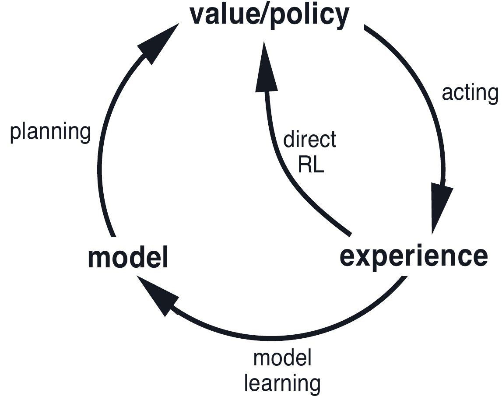
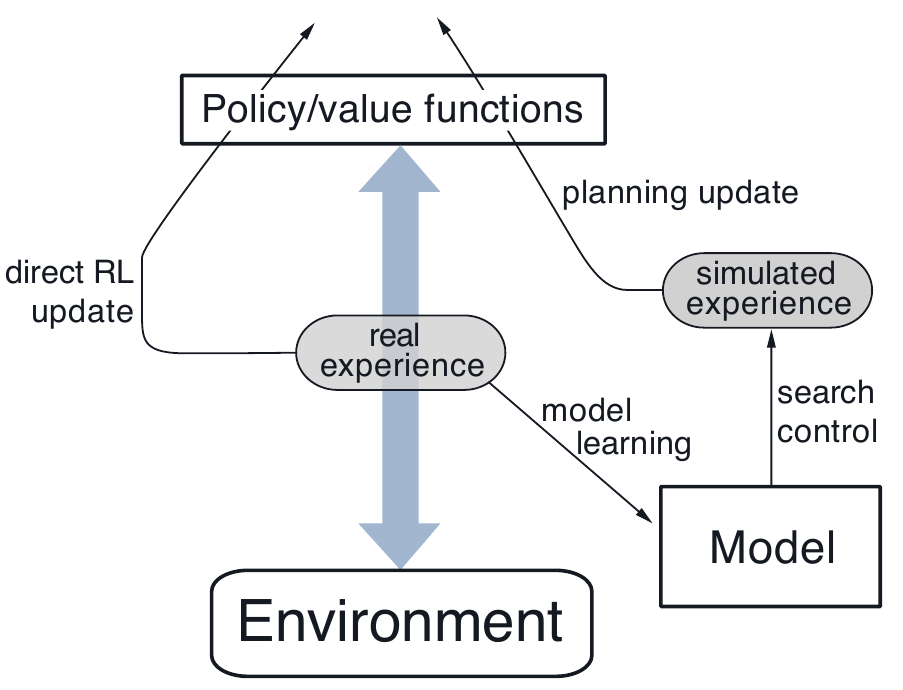
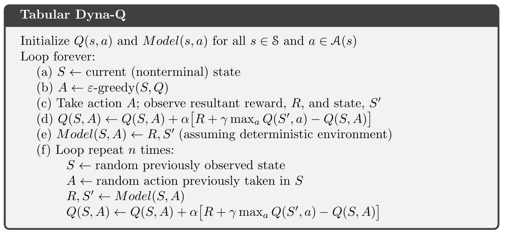
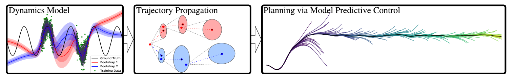

# Model-based Reinforcement Learning

<!-- ---------------------------------------------------------------------------------------- -->
<!-- TITLE SLIDE -->
<!-- ---------------------------------------------------------------------------------------- -->

<!-- ---------------------------------------------------------------------------------------- -->
<!-- TABLE OF CONTENTS SLIDE -->
<!-- ---------------------------------------------------------------------------------------- -->

<!-- The table of contents outputs the sections and subsections that appear in your presentation, specified with the standard \section and \subsection commands. You may either display all sections and subsections on one slide with \tableofcontents, or display each section at a time on subsequent slides with \tableofcontents[pausesections]. The latter is useful if you want to step through each section and mention what you will discuss. -->

#### Contents Overview

<!-- \tableofcontents[pausesections] % Output the table of contents (break sections up across separate slides) -->

<!-- ---------------------------------------------------------------------------------------- -->
<!-- PRESENTATION BODY SLIDES -->
<!-- ---------------------------------------------------------------------------------------- -->

## Tabular Model-based RL

<!-- ------------------------------------------------ -->

### Models and Planning

#### Models and Planning

Some planning examples we've learned so far:
- Dynamic Programming

Other planning examples you may have heard:
- Shortest path
  - Dijkstra
  - A*
- Model predictive control

What is model?

- State transition model $p(s'|s,a)$
- Reward model $p(r|s, a)$

#### Models and Planning

General framework for model-based reinforcement learning,

### Dyna

#### Dyna

The general Dyna Architecture. Real experience are data interacted with the environment and simulated experience are data generated from the learned model.

#### Dyna

Dyna algorithm in Tabular environments

## SOTA Model-based RL Papers

### PETS

#### PETS

**Introduction**

<!-- \footcite{2002_Bourgault_InfoExploration} -->

Deep Reinforcement Learning in a Handful of Trials
using Probabilistic Dynamics Models (PETS) [1]
<!-- \footfullcite{2018NIPS_PETS} -->

*PETS overview*
<!-- \label{fig:my_label} -->

Some key components:
- Learn dynamic model with uncertainty
- Trajectory propagation
- Plan with model predictive control (MPC)

#### PETS

**Learn dynamic model with uncertainty**

Output of a probabilistic neural network for dynamics model learning:
$$\hat{f} = p(s_{t+1}|s_t, a_t) = \mathcal{N}\left( \mu_{\theta}(s_t, a_t), \Sigma_{\theta}(s_t, a_t) \right)$$

where $\theta$ denotes the network weights.

Loss function as negative log likely-hood
$$
loss(\theta) &= - \sum_{n=1}^{N} \log (\hat{f}_{\theta} (s_{t+1}|s_t, a_t)) \\
&= \sum_{n=1}^{N} \Big[ [\mu_{\theta}(s_n, a_n) - s_{n+1}]^{\top} \Sigma_{\theta}^{-1}(s_n, a_n)[\mu_{\theta}(s_n, a_n) - s_{n+1}] \\
&+ \log (\det \Sigma_{\theta}(s_n, a_n)) \Big]
$$

$N$ denotes the size of the training data $\mathcal{D}$

#### PETS

**Learn dynamic model with uncertainty**

Two type of uncertainties:
- **Aleatoric uncertainty**: arises from inherent stochasticities of a system.
- **Epistemic uncertainty**: corresponds to subjective uncertainty about the dynamics function, due to a lack of sufficient data to uniquely determine the underlying system exactly.

The above method which make network output mean and covariance, can formulate the aleatoric uncertainty.

What about epistemic uncertainty?

**Ensembles**!

Get $B$ dynamics model estimators $\hat{f}(\theta_b), \forall b \in [1, 2, \cdots, B]$, where $B$ denotes number of bootstrap models, with each model denoting as $b$.

#### PETS

**Trajectory propagation**

We call each trajectory from $t$ to $t+T$ a **particle**.
Each particle starts at $s_{t=0}$:
$$s_{t=0}^p = s_0,  \forall p$$

Assume we have a sequence of actions $a_{t:t+T} = [a_t, \cdots, a_{t+T}]$. (We will talk about action selection later)

Next state sampled from one of the $B$ ensembles:
$$s_{t+1}^p \sim \hat{f}_{\theta_b(p,t)}(s_{t}^p, a_t)$$

This is call **trajectory sampling (TS)**.

Two types of TS:

- TS1 : Particles uniformly re-sampling a bootstrap per time step.
- TS$\infty$: Use the same ensemble til the end ($t+T$).

#### PETS

**Plan with MPC**

To get optimal actions, we will
optimize $M$ sequences of actions $[a_{t:t+T}^1,  a_{t:t+T}^2, \cdots, a_{t:t+T}^M]$ over rewards. (The paper use a MPC method called CEM)

$$a_{t:t+T}^* = \argmax_{a_{t:t+T}} \sum_{\tau=t}^{T} \mathbb{E}_{\hat{f}} [r(s_{\tau}, a_{\tau})]$$

Here reward functions $r(s_{\tau}, a_{\tau})$ are all known and no learning is involved.

Recall we just got $P$ particles of trajectories. Then here we have
$$\mathbb{E}_{\hat{f}} [r(s_{\tau}, a_{\tau})] = \frac{1}{P} \sum_{p=1}^P r(s_{\tau}^{p}, a_{\tau})$$

Then just apply the first action $a_t^{*}$ after solving all optimal action $a_{t:t+T}^*$.

<!-- \subsection{MBPO} -->

<!-- \begin{frame}[t] -->
<!-- \frametitle{MBPO} -->
<!-- \framesubtitle{Introduction} -->

<!-- When to Trust Your Model: -->
<!-- Model-Based Policy Optimization \cite{2019NIPS_MBPO} -->

<!-- \end{frame} -->

#### References

<!-- \bibliographystyle{unsrt} -->
<!-- \bibliography{ref} -->

## References

[1] Kurtland Chua, Roberto Calandra, Rowan McAllister, Sergey Levine. “Deep Reinforcement Learning in a Handful of Trials using Probabilistic Dynamics Models.” *Neural Information Processing Systems*. (2018).
