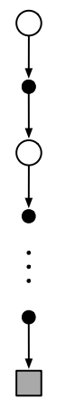
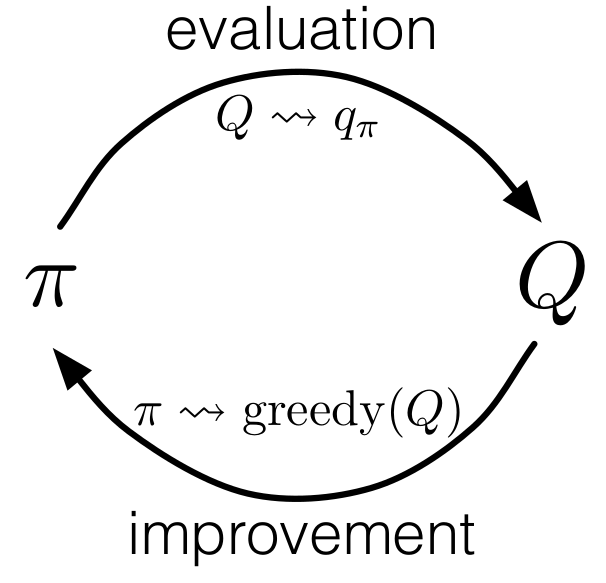
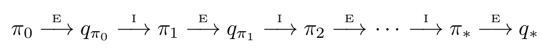
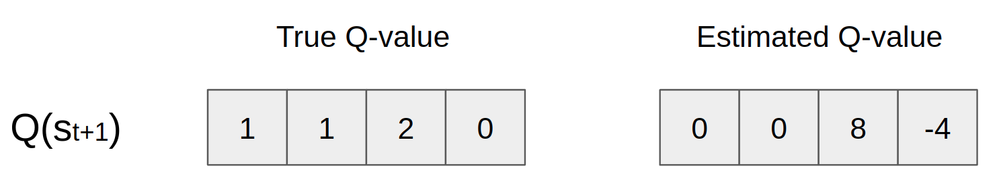
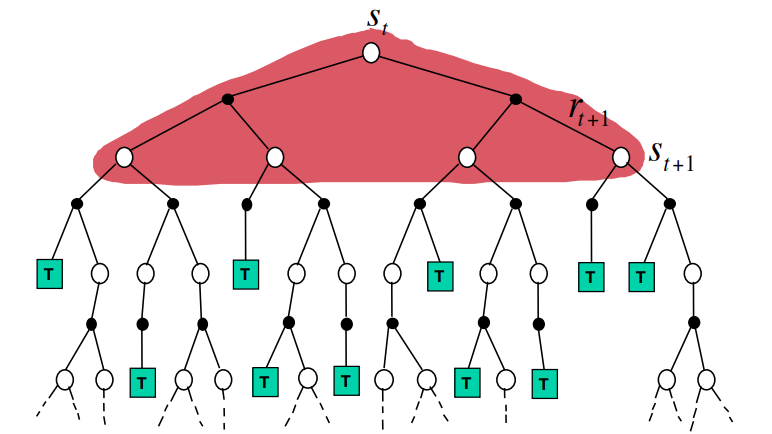
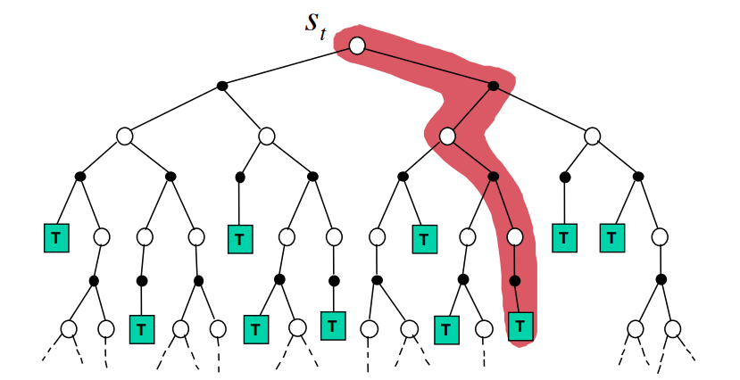
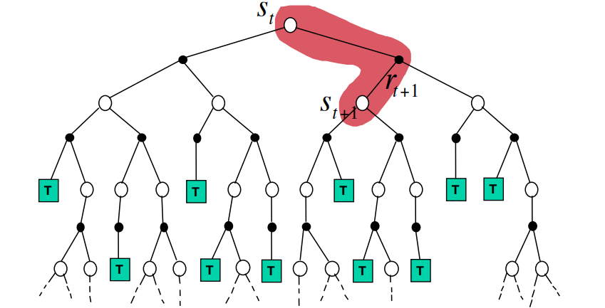
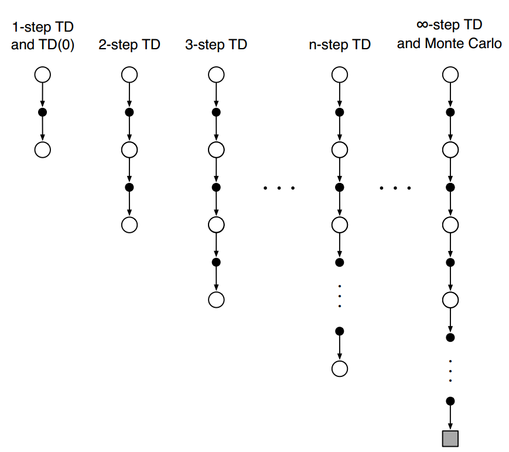

# Model-free Methods (1): Monte Carlo Methods

#### Contents Overview

## Model-free Methods: An Overview

#### Why model-free methods

In previous lecture, we talked about Dynamic programming:

Policy iteration and value iteration all need model $p(s',|s, a)$

What if the model does not exist?

In reality, it IS often the case.

Then, how can we learn value function and policy?

- We use **sample experiences** which consists of trajectories $\{s_0, a_0, r_0, \cdots \}$ in many episodes.
- These sample experiences are acquired by interacting with the environments by certain policies.
- The value or policy are often optimized in an online manner. (We also have offline RL, which will be introduced later)

#### Why model-free methods

Common model-free methods we will discuss:
- Model-free Prediction: Monte-Carlo (MC) Prediction, Temporal-Difference (TD) prediction
- Model-free Control: MC Control, TD Control

In the reinforcement learning context, we refer prediction and control as:

- Prediction: Learn value function ($V$ or $Q$)
- Control: Learn policy $\pi$

## Monte Carlo Prediction

#### Monte Carlo Prediction

General Idea:

Learn Value function from samples:

- $V(s) = \text{average of returns}$ of many different sample episodes.
- By law of large number, $V(s) \rightarrow V_{\pi}(s)$ as $N(s) \rightarrow \infty$, where $N(s)$ is the number that $s$ is visited.

**First-visit MC**: Estimate value function $V(s)$ as the average of the returns following first visits to state $s$.

**Every-visit MC**: Averages the returns following all
visits to $s$

Backup table of MC methods is straightforward:


#### Monte Carlo Prediction

Algorithm: First-visit MC prediction for estimating $V=V_{\pi}$
```python
def first_visit_mc_prediction(episodes, gamma, V=None, returns=None):
    """Estimate V from episodes of (state, action, reward) tuples."""
    V = {} if V is None else V
    returns = {} if returns is None else returns

    for episode in episodes:
        G = 0.0
        episode_returns = [0.0] * len(episode)

        for t in range(len(episode) - 1, -1, -1):
            state, _action, reward = episode[t]
            G = gamma * G + reward
            episode_returns[t] = G

        visited = set()
        for (state, _action, _reward), G in zip(episode, episode_returns):
            if state not in visited:
                visited.add(state)
                returns.setdefault(state, []).append(G)
                V[state] = sum(returns[state]) / len(returns[state])

    return V, returns
```

#### Monte Carlo Prediction

In the algorithm we need to compute average of $G_{all}$ at each iteration:
$$V(s_t) \leftarrow G_{all}(s)\text{.average()}$$

It could be slow since we have to compute the average each time there is new $G$ inserted in $G_{all}$.

Can we use the computation in previous iteration?

#### Monte Carlo Prediction

We can use iterative update:

Suppose a sequence of returns $G_1, G_2, \cdots, G_n$, all starting from same state. We have,
$$
\begin{aligned}
V_n &= \frac{1}{n} \sum_{i=1}^n G_i \\
&=\frac{1}{n} \left( G_n + \sum_{i=1}^{n-1} G_i \right) \\
&=\frac{1}{n} \left( G_n + (n-1) \frac{1}{n-1} \sum_{i=1}^{n-1} G_i \right) \\
&=\frac{1}{n} \left( G_n + (n-1) V_{n-1} \right) \\
&=\frac{1}{n} \left( G_n + n V_{n-1} - V_{n-1} \right) \\
&= V_{n-1} + \frac{1}{n} \left( G_n - V_{n-1} \right) \\
\end{aligned}
$$

This allows us to use $V_{n-1}$ which is from last iteration to compute $V_n$. It is more efficient.

#### Monte Carlo Estimation of Action Values

We also need to estimate action value function $Q(s, a)$. It is essential for MC control tasks.

Here we care about not just the state $s$, but state-action pair $(s,a)$.

Algorithm: MC Estimation of Action Value Function
```python
def mc_action_value_estimation(episodes, gamma, Q=None, returns=None):
    """Estimate Q from episodes of (state, action, reward) tuples."""
    Q = {} if Q is None else Q
    returns = {} if returns is None else returns

    for episode in episodes:
        G = 0.0
        episode_returns = [0.0] * len(episode)

        for t in range(len(episode) - 1, -1, -1):
            state, action, reward = episode[t]
            G = gamma * G + reward
            episode_returns[t] = G

        visited = set()
        for (state, action, _reward), G in zip(episode, episode_returns):
            state_action = (state, action)
            if state_action not in visited:
                visited.add(state_action)
                returns.setdefault(state_action, []).append(G)
                Q[state_action] = sum(returns[state_action]) / len(returns[state_action])

    return Q, returns
```

Can you come up with the iterative update for $Q(s,a)$?

(hint: Refer to iterative update for $V(s)$ in previous page)

## Monte Carlo Control

#### Monte Carlo Control

Recall Generalized Policy Improvement in last lecture:

In DP, we have model, here we don't. Thus we get policy from action value function.

Here's the illustration of model-free general policy improvement:


We iteratively improve policy via Q-value til the optimal Q is found:



Then we simply get optimal policy greedily:
$$\pi(s) = \argmax_a Q(s,a)$$

#### Exploration and Exploitation

Exploration: Choose non-optimal action to try other actions and gain more information.

Exploitation: Use existing information, e.g. choose action based on optimal Q value.

One example of exploration policy: $\epsilon-$greedy

$$
\begin{aligned}
\pi(a|s) =
\begin{cases}
\argmax_a Q(s,a) & \text{with $1-\epsilon$ probability} \\
\text{random action} & \text{with $\epsilon$ probability}
\end{cases}
\end{aligned}
$$

#### Monte Carlo Control

Algorithm: On-policy first-visit MC control
```python
def on_policy_first_visit_mc_control(
    generate_episode, states, actions, num_episodes, gamma, epsilon, Q=None, returns=None
):
    """generate_episode(policy) returns (state, action, reward) tuples."""
    Q = {(state, action): 0.0 for state in states for action in actions} if Q is None else Q
    returns = {} if returns is None else returns
    policy = {
        state: {action: 1.0 / len(actions) for action in actions}
        for state in states
    }

    for _ in range(num_episodes):
        episode = generate_episode(policy)
        G = 0.0
        episode_returns = [0.0] * len(episode)

        for t in range(len(episode) - 1, -1, -1):
            state, _action, reward = episode[t]
            G = gamma * G + reward
            episode_returns[t] = G

        visited = set()
        for (state, action, _reward), G in zip(episode, episode_returns):
            state_action = (state, action)
            if state_action in visited:
                continue
            visited.add(state_action)

            returns.setdefault(state_action, []).append(G)
            Q[state_action] = sum(returns[state_action]) / len(returns[state_action])

            greedy_action = max(actions, key=lambda candidate: Q.get((state, candidate), 0.0))
            n_actions = len(actions)
            policy[state] = {
                candidate: epsilon / n_actions
                + (1.0 - epsilon if candidate == greedy_action else 0.0)
                for candidate in actions
            }

    return policy, Q, returns
```

## Off-policy Learning via Importance Sampling

#### Off-policy Learning via Importance Sampling

**What is off-policy? Why off-policy?**

**On-policy methods**:

The DP methods we introduced previously, such as policy iteration and value iteration are all **on-policy** methods. There is just one policy.

**Off-policy methods**:

We apply two policies, one learns value function with optimal actions, another one behaves non-optimally to explore all actions.

The two polices we use:
- **Target policy**: The policy being learned
- **Behavior policy**: Policy used to generate behavior

#### Off-policy Learning via Importance Sampling

**Off-policy: pros and cons**

Advantages:
- More powerful and general
- Learn from data generated from non-RL algorithm (e.g. traditional controller, planner) or human, often called offline RL now.

Disadvantages:
- Larger variance
- Slower to converge

#### Off-policy Learning via Importance Sampling

Given state-action trajectory (a trajectory without reward)
$$\tau_{\pi} = \{s_t, a_t, s_{t+1}, a_{t+1}, \cdots, s_{T} \}$$

Probability following policy $\pi$,
$$
\begin{aligned}
p_{\tau_{\pi}} &= \pi(a_t|s_t) p(s_{t+1}|a_t, s_t) \cdots  \pi(a_{T-1}|s_{T-1}) p(s_T|a_{T-1}, s_{T-1}) \\
&= \prod_{k=t}^T \pi(a_k|s_k) p(s_{k+1} | s_k, a_k)
\end{aligned}
$$

If we have both behaviour policy $b$ and target policy $\pi$,
$$
\begin{aligned}
\rho_{t:T} &=  \frac{\prod_{k=t}^T \pi(a_k|s_k) p(s_{k+1} | s_k, a_k)}{\prod_{k=t}^T b(a_k|s_k) p(s_{k+1} | s_k, a_k)}
= \prod_{k=t}^T \frac{\pi(a_k|s_k)}{b(a_k|s_k)}
\end{aligned}
$$

Then the value function can be computed as,
$$
\begin{aligned}
\mathbb{E}[\rho_{t:T} G_t | s_t = s] = V_{\pi}(s)
\end{aligned}
$$

#### Off-policy Learning via Importance Sampling

Two specific value learning approaches. Here $ST(s)$ denotes the set of all time steps in which state $s$ is visited.

Averaged by visitation count, hence ordinary importance sampling:

$$
\begin{aligned}
V_{\pi}(s) = \frac{\sum_{t \in ST(s)} \left[ \rho_{t:T} G_t \right] }{|ST(s)|}
\end{aligned}
$$

Averaged by importance weights, hence weighted importance sampling:

$$
\begin{aligned}
V_{\pi}(s) = \frac{\sum_{t \in ST(s)} \left[ \rho_{t:T} G_t \right] }{\sum_{t \in ST(s)}}
\end{aligned}
$$

#### Incremental Updates

Suppose a sequence of returns $G_1, G_2, \cdots, G_n$, all starting from same state, with a bit notation changes:

$$w = \rho_{t:T} $$

Value function is:
$$
\begin{aligned}
V_n &= \frac{\sum_{k=1}^{n} \left( w_k G_k \right) }{\sum_{k=1}^{n} w_k} = \frac{\sum_{k=1}^{n} \left( w_k G_k \right) }{C_n}
\end{aligned}
$$

Value function after getting a new $G_{n+1}$
$$
\begin{aligned}
V_{n+1} &= \frac{\sum_{k=1}^{n+1} \left( w_k G_k \right) }{\sum_{k=1}^{n+1} w_k} \\
&= V_n + \frac{w_{n+1}}{C_{n+1}} [G_{n+1} - V_n]
\end{aligned}
$$

with
$$C_{n+1} = C_n + w_{n+1}$$

#### Incremental Updates

Proof is shown here:
$$
\begin{aligned}
V_{n+1} &= \frac{\sum_{k=1}^{n} ( w_k G_k ) + w_{n+1}G_{n+1} }{\sum_{k=1}^{n} w_k} \frac{\sum_{k=1}^{n} w_k}{\sum_{k=1}^{n+1} w_k} \\
&= \left( V_n + \frac{w_{n+1}G_{n+1} }{C_{n}} \right) \frac{C_{n}}{C_{n+1}} \\
&= \frac{V_n C_{n}}{C_{n+1}}  + \frac{w_{n+1}G_{n+1} }{C_{n+1}} \\
&= V_n + \frac{V_n C_{n}}{C_{n+1}}  - V_n + \frac{w_{n+1}G_{n+1} }{C_{n+1}}  \\
&= V_n + \frac{V_n C_{n} - V_n C_{n+1}}{C_{n+1}}  + \frac{w_{n+1}G_{n+1} }{C_{n+1}}  \\
&= V_n + \frac{-V_n w_{n+1}}{C_{n+1}}  + \frac{w_{n+1}G_{n+1} }{C_{n+1}}  \\
&= V_n + \frac{w_{n+1}}{C_{n+1}} [G_{n+1} - V_n]
\end{aligned}
$$

#### Off-policy MC control

Algorithm: Off-policy MC control
```python
def off_policy_mc_control(episodes, actions, gamma, Q=None, C=None):
    """Each step is (state, action, reward, behavior_probability)."""
    Q = {} if Q is None else Q
    C = {} if C is None else C
    policy = {}

    for episode in episodes:
        G = 0.0
        weight = 1.0

        for state, action, reward, behavior_probability in reversed(episode):
            G = gamma * G + reward
            state_action = (state, action)
            C[state_action] = C.get(state_action, 0.0) + weight
            old_value = Q.get(state_action, 0.0)
            Q[state_action] = old_value + (weight / C[state_action]) * (G - old_value)

            policy[state] = max(actions, key=lambda candidate: Q.get((state, candidate), 0.0))
            if action != policy[state]:
                break

            weight /= behavior_probability

    return policy, Q, C
```

# Model-free Methods (2): Temporal Difference Methods

#### Contents Overview

## TD(Temporal Difference) Prediction

### TD prediction intro

#### TD (Temporal Difference) Prediction

Recall Bellman equation:

$$V_{\pi}(s_{t}) = \mathbb{E}_{\pi, p(s_{t+1}|s_{t},a)} \left[ r_{t+1} + \gamma V(s_{t+1}) \right]$$

Given a trajectory $\tau_{\pi} = \{s_0, a_0, r_0, \cdots, s_t, a_t, r_t, s_{t+1}, a_{t+1}, r_{t+1}, \cdots \}$

If the $\tau_{\pi}$ is given, we do NOT need to compute  $\mathbb{E}_{\pi, p(s_{t+1}|s_{t},a)}$

So we have,
$$V(s_{t}) = r_{t+1} + \gamma V(s_{t+1})$$

if $V(s_{t})$ and $V(s_{t+1})$ are accurate.

If we estimate $V(s_{t})$ with $r_{t+1} + \gamma V(s_{t+1})$, there's usually an error:
$$\delta_t = r_{t+1} + \gamma V(s_{t+1}) - V(s_{t})$$

This is called **TD error**. And $r_{t+1} + \gamma V(s_{t+1})$ is called **TD target**

#### TD (Temporal Difference) Prediction

In order to learn $V({s_t})$ based on reward $r_{t+1}$ and $V({s_{t+1}})$, we can apply:
$$
\begin{aligned}
V(s_{t}) &= V(s_{t}) + \alpha \delta_t \\
&= V({s_{t}}) + \alpha \left[ r_{t+1} + \gamma V(s_{t+1}) - V(s_{t}) \right]
\end{aligned}
$$

where $\alpha$ is the learning rate.

when $\delta_t \rightarrow 0$, $V(s_{t})$ will converge.

We apply the estimation of the next state, this approach is called **boot-strapping**

### Compare TD with MC prediction

#### Compare TD with MC prediction

We have only first TD learning algorithm: TD(0) prediction:

Algorithm: TD(0) for estimating $V_{\pi}$
```python
def td0_prediction(initial_state, take_step, policy, num_episodes, max_steps,
                   alpha, gamma, V=None):
    """take_step(state, action) returns (next_state, reward, done)."""
    V = {} if V is None else V

    for _ in range(num_episodes):
        state = initial_state()

        for _ in range(max_steps):
            action = policy(state)
            next_state, reward, done = take_step(state, action)
            V[state] = V.get(state, 0.0) + alpha * (
                reward + gamma * V.get(next_state, 0.0) - V.get(state, 0.0)
            )
            state = next_state
            if done:
                break

    return V
```

#### Compare TD with MC prediction

Previous MC prediction in incremental implementation:

$$V_n = V_{n-1} + \frac{1}{n} \left( G_n - V_{n-1} \right)$$

Slightly notation changing we have constant-$\alpha$ MC prediction:

$$V(s_{t}) = V(s_{t}) + \alpha \left( G_t - V(s_{t}) \right) $$

Adn for TD prediction:

$$V({s_{t}}) = V({s_{t}}) + \alpha \left[ r_{t+1} + \gamma V(s_{t+1}) - V(s_{t}) \right] $$

For MC: when $N \rightarrow \infty$, $G_t = V(s_{t})$

#### Compare TD with MC prediction

MC error and TD error relationship:
$$
\begin{aligned}
G_t - V(s_t) &= r_{t+1} + \gamma G_{t+1} - V(s_t) + \gamma V(s_{t+1}) - \gamma V(s_{t+1}) \\
&= \delta_t + \gamma(G_{t+1} - V(s_{t+1})) \\
& = \delta_t + \gamma(\delta_{t+1} + \gamma(G_{t+2} - V(s_{t+2}))) \\
& = \delta_t + \gamma\delta_{t+1} + \gamma^2(G_{t+2} - V(s_{t+2}))) \\
& = \delta_t + \gamma\delta_{t+1} + \gamma^2\delta_{t+2} + \cdots + \gamma^{T-t-1}\delta_{T-1} + \gamma^{T-1}(G_{T} - V(s_{T}))) \\
& = \delta_t + \gamma\delta_{t+1} + \gamma^2\delta_{t+2} + \cdots + \gamma^{T-t-1}\delta_{T-1} + \gamma^{T-1}(r_{T} - r_{T}) \\
& = \sum_{k=t}^{T-1} \gamma^{k-t} \delta_k
\end{aligned}
$$

## TD Control

#### TD Control

We extend state value to action value:
$$Q(s_{t}, a_{t}) = Q(s_{t}, a_{t}) + \alpha \left[ r_{t+1} + \gamma Q(s_{t+1}, a_{t+1}) - Q(s_{t}, a_{t}) \right] $$

We have TD target and TD error for action value function:

TD target: $$r_{t+1} + \gamma Q(s_{t+1}, a_{t+1})$$

TD error: $$\delta_t = \left[ r_{t+1} + \gamma Q(s_{t+1}, a_{t+1}) - Q(s_{t}, a_{t}) \right]$$

### SARSA

#### SARSA

**On policy TD control**

SARSA is short for State, Action, Reward, State, Action

which is $(s_t, a_t, r_t, s_{t+1}, a_{t+1})$

Algorithm: SARSA

```python
def sarsa(initial_state, take_step, epsilon_greedy, actions, num_episodes,
          max_steps, alpha, gamma, epsilon, Q=None):
    """take_step(state, action) returns (next_state, reward, done)."""
    Q = {} if Q is None else Q

    for _ in range(num_episodes):
        state = initial_state()
        action = epsilon_greedy(Q, state, actions, epsilon)

        for _ in range(max_steps):
            next_state, reward, done = take_step(state, action)
            state_action = (state, action)
            old_value = Q.get(state_action, 0.0)
            if done:
                next_value = 0.0
            else:
                next_action = epsilon_greedy(Q, next_state, actions, epsilon)
                next_value = Q.get((next_state, next_action), 0.0)
            Q[state_action] = old_value + alpha * (
                reward + gamma * next_value - old_value
            )
            if done:
                break
            state, action = next_state, next_action

    return Q
```

### Q-Learning

#### Q-Learning

**Off policy TD control**

The updating equation for Q-learning:

$$Q(s_{t}, a_{t}) = Q(s_{t}, a_{t}) + \alpha \left[ r_{t+1} + \gamma \max_a Q(s_{t+1}, a) - Q(s_{t}, a_{t}) \right] $$

Why is this off-policy?

- Target policy is greedy: $\max_a Q(s', a)$, behaviour policy is $\epsilon-$greedy
- One Q-value for two policies.

#### Q-Learning

**Off policy TD control**

This gives us the Q-learning algorithm

Algorithm: Q-Learning

```python
def q_learning(initial_state, take_step, epsilon_greedy, actions, num_episodes,
               max_steps, alpha, gamma, epsilon, Q=None):
    """take_step(state, action) returns (next_state, reward, done)."""
    Q = {} if Q is None else Q

    for _ in range(num_episodes):
        state = initial_state()

        for _ in range(max_steps):
            action = epsilon_greedy(Q, state, actions, epsilon)
            next_state, reward, done = take_step(state, action)
            state_action = (state, action)
            old_value = Q.get(state_action, 0.0)
            next_value = 0.0 if done else max(
                Q.get((next_state, candidate), 0.0) for candidate in actions
            )
            Q[state_action] = old_value + alpha * (
                reward + gamma * next_value - old_value
            )
            state = next_state
            if done:
                break

    return Q
```

### Expected SARSA

#### Expected SARSA

SARSA compute TD target based on $a_{t+1} = \epsilon{\text{-greedy}}(Q(s_{t+1}))$
$$Q(s_{t}, a_{t}) = Q(s_{t}, a_{t}) + \alpha \left[ r_{t+1} + \gamma Q(s_{t+1}, a_{t+1}) - Q(s_{t}, a_{t}) \right] $$

**Expected SARSA**:

(the rest procedures are the same as Q-learning)
$$
\begin{aligned}
Q(s_{t}, a_{t}) &= Q(s_{t}, a_{t}) + \alpha \left[ r_{t+1} + \gamma \mathbb{E}_{\pi} \left[ Q(s_{t+1}, a_{t+1}) \right] - Q(s_{t}, a_{t}) \right] \\
&= Q(s_{t}, a_{t}) + \alpha \left[ r_{t+1} + \gamma \sum_{a \in |\mathcal{A}|} \left[ \pi(a|s_{t+1}) Q(s_{t+1}, a_{t+1}) \right] - Q(s_{t}, a_{t}) \right]
\end{aligned}
$$

Looks familiar? Recall Bellman equation for Q-value:
$$
\begin{aligned}
Q_{\pi}(s, a) &= \sum_{s' \in \mathcal{S}, r \in \mathcal{R}} p(s', r | s, a) \left[r + \gamma \sum_{a'} \pi(a'|s') Q_{\pi}(s', a') \right]
\end{aligned}
$$

In TD learning, we don't have access to $p(s', r | s, a)$.

#### Expected SARSA

Expected SARSA:
- **Stochastic** policy for TD target computation
- Expectation of Q-value over policy for TD target

SARSA:
- **Stochastic** policy for TD target computation
- Single Q-value for TD target

Q-Learning:
- **Deterministic** policy for TD target computation
- Single Q-value for TD target

```python
def expected_sarsa(initial_state, take_step, epsilon_greedy, actions,
                   num_episodes, max_steps, alpha, gamma, epsilon, Q=None):
    """take_step(state, action) returns (next_state, reward, done)."""
    Q = {} if Q is None else Q
    n_actions = len(actions)

    for _ in range(num_episodes):
        state = initial_state()

        for _ in range(max_steps):
            action = epsilon_greedy(Q, state, actions, epsilon)
            next_state, reward, done = take_step(state, action)
            state_action = (state, action)
            old_value = Q.get(state_action, 0.0)

            if done:
                expected_next_value = 0.0
            else:
                greedy_action = max(
                    actions, key=lambda candidate: Q.get((next_state, candidate), 0.0)
                )
                expected_next_value = sum(
                    (epsilon / n_actions
                     + (1.0 - epsilon if candidate == greedy_action else 0.0))
                    * Q.get((next_state, candidate), 0.0)
                    for candidate in actions
                )

            Q[state_action] = old_value + alpha * (
                reward + gamma * expected_next_value - old_value
            )
            state = next_state
            if done:
                break

    return Q
```

### Double Q-Learning

#### Double Q-Learning

Overestimation of Q-value:

for SARSA and Q-learning, TD target computation all involve $\max_a$

SARSA:
$$a_{t+1} = \epsilon\text{-greedy}(Q(s_{t+1}))$$
$$Q(s_{t}, a_{t}) = Q(s_{t}, a_{t}) + \alpha \left[ r_{t+1} + \gamma Q(s_{t+1}, a_{t+1}) - Q(s_{t}, a_{t}) \right] $$

Q-Learning:
$$Q(s_{t}, a_{t}) = Q(s_{t}, a_{t}) + \alpha \left[ r_{t+1} + \gamma \max_a Q(s_{t+1}, a) - Q(s_{t}, a_{t}) \right] $$

Potential Problem:

TD targets are overestimated, making the final Q-value overestimated (Recall the accumulation of TD error). We call this **maximization bias**.

#### Double Q-Learning

Overestimation of Q-value in Q-Learning:


We can see this will give us same greedy policy:
$$\argmax_a{Q(s_{t+1}, a)} = \argmax_a{\hat{Q}(s_{t+1}, a)}$$

But the TD target is larger
$$r_{t+1} + \max_a{\hat{Q}(s_{t+1}, a)} > r_{t+1} + \max_a{Q(s_{t+1}, a)}$$

Overtime:
$$\hat{Q}(s_{t}, a_t) \rightarrow r_{t+1} + \max_a{\hat{Q}(s_{t+1}, a)}$$

#### Double Q-Learning

Source of overestimation:

We use the same set Q-value to determine optimal action, and estimate its value.

How to solve this?

- Use different Q-value to determine optimal action and update its value
- Implementation-wise: Use two copies of Q value.

One of the update would be like:
$$Q_1(s_{t}, a_{t}) = Q_1(s_{t}, a_{t}) + \alpha \left[ r_{t+1} + \gamma Q_2(s_{t+1}, \argmax_a Q_1(s', a) ) - Q_1(s_{t}, a_{t}) \right]$$

Hence using $Q_1$ to choose optimal action, $Q_2$ to update its TD target.

#### Double Q-Learning

Algorithm: Double Q-Learning

```python
import random


def double_q_learning(initial_state, take_step, epsilon_greedy, actions,
                      num_episodes, max_steps, alpha, gamma, epsilon,
                      Q1=None, Q2=None):
    """take_step(state, action) returns (next_state, reward, done)."""
    Q1 = {} if Q1 is None else Q1
    Q2 = {} if Q2 is None else Q2

    for _ in range(num_episodes):
        state = initial_state()

        for _ in range(max_steps):
            action = epsilon_greedy(Q1, Q2, state, actions, epsilon)
            next_state, reward, done = take_step(state, action)
            state_action = (state, action)

            if random.random() < 0.5:
                best_next_action = max(
                    actions, key=lambda candidate: Q1.get((next_state, candidate), 0.0)
                )
                next_value = 0.0 if done else Q2.get((next_state, best_next_action), 0.0)
                old_value = Q1.get(state_action, 0.0)
                Q1[state_action] = old_value + alpha * (
                    reward + gamma * next_value - old_value
                )
            else:
                best_next_action = max(
                    actions, key=lambda candidate: Q2.get((next_state, candidate), 0.0)
                )
                next_value = 0.0 if done else Q1.get((next_state, best_next_action), 0.0)
                old_value = Q2.get(state_action, 0.0)
                Q2[state_action] = old_value + alpha * (
                    reward + gamma * next_value - old_value
                )

            state = next_state
            if done:
                break

    return Q1, Q2
```

## DP, MC, TD Comparisons

#### DP, MC, TD Comparison

Dynamic Programming: compute expectation over all different next states:

$$V(s_{t}) = \mathbb{E}_{\pi, p(s_{t+1}|s_{t},a)} \left[ r_{t+1} + \gamma V(s_{t+1}) \right]$$



#### DP, MC, TD Comparison

MC method: compute return til the end state:

$$ V(s_{t}) = V(s_{t}) + \alpha \left( G_t - V(s_{t}) \right) $$



#### DP, MC, TD Comparison

TD method: exploit the estimation in next state:

$$V({s_{t}}) = V({s_{t}}) + \alpha \left[ r_{t+1} + \gamma V(s_{t+1}) - V(s_{t}) \right] $$



#### DP, MC, TD Comparison

Bootstrapping: update involves estimates of next state(s)
- MC does not bootstrap
- DP bootstraps
- TD bootstraps

Sampling: update by sampling and computing mean
- MC samples
- DP does not sample
- TD samples

#### DP, MC, TD Comparison

MC and TD: pros and cons:

In terms of Markov property:

- TD exploits Markov property (Usually more efficient in Markov environments)
- MC does not exploit Markov property (Usually more effective in non-Markov environments)

In terms of ending episodes:

- MC updates estimation until the end of episode
- TD update by just taking one step (n-step TD could take more than one step)

In terms of bias/variance:

- MC has high variance, low bias
- TD has high bias, low variance

## n-step Bootstrapping

#### n-step Bootstrapping

From 1-step TD (TD(0)) to Monte-Carlo ($\infty$- step of TD)



We can trade-off between TD(0) and MC methods with n-step TD.

#### n-step Bootstrapping

Given a trajectory $\tau = \{s_0, a_0, r_0, \cdots, s_{T-1}, a_{T-1}, r_{T-1}\}$

We can compute Full return:
$$G_t = r_t + \gamma r_{t+1} + \gamma^2 r_{t+2} + \cdots + \gamma^{T-t} r_T = \sum_{k=0}^{T-t} \gamma^k r_{t+k}$$

One-step return (TD(0)):
$$G_{t:t+1} = r_t + \gamma V_t(s_{t+1})$$

Two-step return:
$$G_{t:t+2} = r_t + \gamma r_{t+1} + \gamma^2 V_{t+1}(s_{t+2})$$

n-step return:
$$G_{t:t+n} = r_t + \gamma r_{t+1} + \cdots + \gamma^{n-1} r_{t+n} + \gamma^n V_{t+n-1}(s_{t+n})$$

### n-step Prediction

#### n-step Prediction

We can apply n-step return for incremental value function estimation just like in Monte-Carlo Method:

$$V_{t+n}(s_{t}) = V_{t+n-1}(s_{t})+ \alpha \left[ G_{t:t+n} - V_{t+n-1}(s_{t}) \right]$$

### n-step Control

#### n-step SARSA

In control domain, we replace $V$ with $Q$.

n-step return based on $Q$-value:
$$G_{t:t+n} = r_t + \gamma r_{t+1} + \cdots + \gamma^{n-1} r_{t+n} + \gamma^n Q_{t+n-1}(s_{t+n}, a_{t+n})$$

Incremental update for $Q$-value

$$Q_{t+n}(s_{t}, a_{t}) = Q_{t+n-1}(s_{t}, a_{t})+ \alpha \left[ G_{t:t+n} - Q_{t+n-1}(s_{t}, a_{t}) \right]$$
