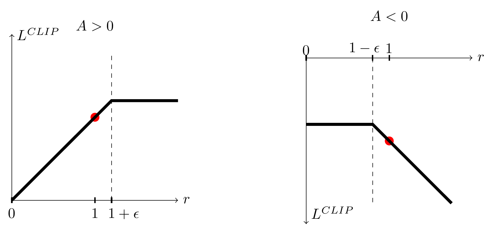
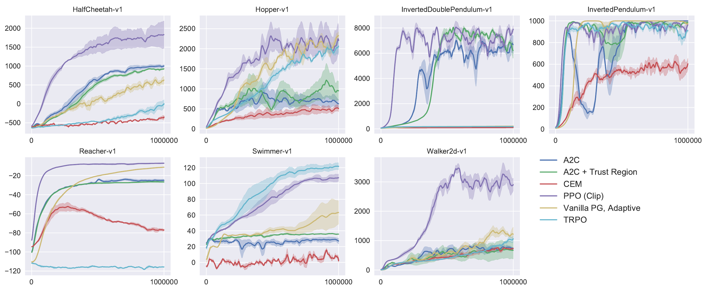

# Notes on PPO

## Introduction

In this note we will talk about one trust region-based policy gradient method - Proximal Policy Gradient (PPO) [1]. PPO is now one of the most widely used policy gradient methods, such as being used in recently insanely popular chatbot-chatGPT. PPO is developed upon Trust Region Policy Optimization (TRPO) [2].

## Key Components

### Quick into to TRPO

The standard policy gradient optimization objective is:
$$
L^{PG} (\theta)  = \mathbb{E} \left[ \log \pi_\theta(a|s) A(s, a) \right]
$$

where $A(s, a)$ is the advantage function.

Thus the gradient is computed as
$$
\nabla_{\theta} L^{PG} (\theta) = \mathbb{E} \left[ \nabla_{\theta} \log \pi_\theta(a|s) A(s, a) \right]
$$

In classic policy gradient methods like DDPG, the policy is optimized by the data collected from the same policy. As the policy being updated in each iteration, new data is generated to optimize the policy but old data in previous iterations cannot be used again. This hinders the sample efficiency of policy gradient methods. To solve this problem, TRPO uses importance sampling to use old data to optimize the policy network. Thus the new objective, called conservative policy iteration (CPI), is written as,
$$
L^{CPI} (\theta)  = \mathbb{E} \left[ \frac{\pi_\theta(a|s)}{\pi_{\theta_{old}}(a|s)} A(s, a) \right] =  \mathbb{E} \left[ \rho(\theta) A(s, a) \right]
$$

This brings another problem, importance sampling ratio $\rho(\theta)$ could be very large or small if the $\pi_\theta$ changes too much compared with $\pi_{\theta_{old}}$. Large policy change may collapse the training. To avoid this issue, TRPO limits the change of policy parameters by constraining the KL divergence of $\pi_\theta$ and $\pi_{\theta_{old}}$. Thus the optimization objective of TRPO is shown as follows, and is called surrogate objective. It constrains the size of the policy update to avoid large policy updates.

$$
\begin{aligned}
& L (\theta)  = \mathbb{E} \left[ \frac{\pi_\theta(a|s)}{\pi_{\theta_{old}}(a|s)} A(s, a) \right] \\
& \text{s.t.     } \mathbb{E} \left[ KL (\pi_\theta(a|s), \pi_{\theta_{old}}(a|s)) \right] \leq \delta
\end{aligned}
$$

This objective can  be approximately solved using the conjugate gradient algorithm, after making a linear approximation to the objective and a quadratic approximation to the constraint.

### PPO

PPO is developed based on TRPO and is much simpler to implement, more general, and have better sample complexity empirically. We will talk about the optimization objectives in the next sub-sections.

#### Clipped Surrogate Objective

Let's first talk about clipped surrogate objective. We can clip the importance ration to avoid overly large change of the policy.
$$
L^{CLIP} (\theta)  = \mathbb{E} \left[ \min(\rho(\theta) A(s,a), \text{clip}(\rho(\theta), 1+\epsilon, 1-\epsilon)A(s,a) \right]
$$

The clip function can be visualized as the following plots. When the advantage function $A$ is positive, any ratio that is larger than $1+\epsilon$ is clipped.

<!-- \label{fig:my_label} -->

#### Adaptive KL Penalty Coefficient

Back to equation [equa:CLP](#equa-CLP), we can solve this unconstrained optimization problem with Lagrangian duality as
$$
L^{KLPEN} (\theta)  = \mathbb{E} \left[ \frac{\pi_{\theta(a|s)}}{\pi_{\theta_{old}}(a|s)} A(s, a) - \beta  KL (\pi_\theta(a|s), \pi_{\theta_{old}}(a|s)) \right]
$$

This is a optimization objective with a KL penalty. This objective can be an alternative to clipped surrogate objective. We also need to change the penalty term $\beta$. The updating rule used in PPO is shown as,
- Set a target KL divergence value $d_{tgt}$ as one of the hyper-parameters
- Compute divergence term as $d = \mathbb{E} \left[ KL (\pi_\theta(a|s), \pi_{\theta_{old}}(a|s))  \right]$
  - if $d < d_{tgt}/1.5$, then $\beta = \beta/2$
  - if $d > d_{tgt} \times 1.5$, then $\beta = \beta \times 2$

The idea is simple, when the current KL divergence value is larger then a threshold, then increase the penalty term $\beta$, other wise decrease it.

#### PPO algorithm

Combining the optimization objectives mentioned before, we have the following final optimization objective used in PPO,
$$
L^{PPO} (\theta)  = \mathbb{E} \left[ L^{CLIP} (\theta) - c_1 (V_{\theta}(s)-V^{tgt})^2 + c_2 S[\pi_{\theta}] (s_t) \right]
$$

$c_1$ and $c_2$ are coefficients. $S$ denotes an entropy bonus term. This objective combines policy optimization, value optimization as well as some exploration brought by the entropy bonus $S$.

The advantage function used in PPO is a $T$ step (much less than the episode length) look-ahead value estimation,
$$
A_t = - V(s_t) + r_t + \gamma r_{t+1} + \cdots + \gamma^{T-t+1} r_{T-1} + \gamma ^{T-t} V(s_{T})
$$

In the implementation of PPO , the algorithm run $N$ actors in parallel.

## Key Experimental Results

Tested in Mujoco environments, PPO outperforms other baseline algorithms in most cases and shows more efficient learning capability.

<!-- \label{fig:my_label} -->

## Summaries and Discussions

Pros:
- PPO can achieve similar and even better results compared with TRPO, but easier to implement.
- PPO is a sample efficient PG algorithm, even more efficient than TRPO.

Cons:
- The $T$ step look-ahead advantage function used in PPO could make the algorithm a bit short-sighted.
- PPO is empirically shown to be sensitive to hyper-parameters.

## References

[1] John Schulman, Filip Wolski, Prafulla Dhariwal, Alec Radford, Oleg Klimov. “Proximal Policy Optimization Algorithms.” *arXiv:1707.06347v2*. (2017).
[2] John Schulman, Sergey Levine, Philipp Moritz, Michael I. Jordan, Pieter Abbeel. “Trust Region Policy Optimization.” *ICML*. (2015).
